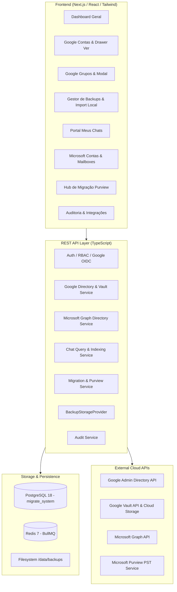

# Arquitetura do Sistema: Google Workspace Backup, Archive & M365 Migration Hub

## 1. Visão Geral
A plataforma é um hub corporativo desenhado para:
1. **Inventariação e Governança:** Inventariar continuamente utilizadores, aliases, grupos de trabalho e membros do Google Workspace e utilizadores/mailboxes do Microsoft 365 (Entra ID).
2. **Extração e Preservação com Google Vault:** Automatizar a solicitação e download assíncrono de backups de Gmail (MBOX), Google Groups (PST/MBOX) e Google Chat (MBOX/JSON), armazenando-os de forma imutável com integridade criptográfica SHA-256 no sistema de ficheiros local.
3. **Arquivo Histórico do Google Chat:** Normalizar, deduplicar e indexar mensagens e anexos do Google Chat no PostgreSQL com pesquisa full-text (`tsvector`/`GIN`), disponibilizando um portal seguro ("Meus Chats") com controlo estrito de acessos (ACL por utilizador).
4. **Migração Oficial para Microsoft 365:** Validar a prontidão técnica e preparar os dados históricos dos Google Groups para importação no Exchange Online através do **Microsoft Purview PST Import Service**, gerando os manifestos CSV canónicos e suportando upload via AzCopy sem recurso a práticas não suportadas (como envio SMTP ou manipulação de flags de rascunho).
5. **Auditoria e Segurança:** Registo imutável de todas as ações (`audit_events`), RBAC estrito a nível de backend e segregação completa de credenciais e segredos.

## 2. Componentes Estruturais

### 2.1 Backend (Node.js & TypeScript)
- **Prisma ORM:** Modelação de 25+ entidades relacionais com chaves primárias UUID, índices em campos de busca frequente e integridade referencial em cascata ou restrita conforme o caso de uso.
- **BullMQ & Redis:** Processamento em segundo plano desemparelhado para sincronização de diretórios, submissão e monitorização de exports do Google Vault, download com streaming e geração de pacotes PST.
- **Storage Abstraction (`BackupStorageProvider`):** Camada desacoplada com implementação nativa `LocalFilesystemStorageProvider` e suporte extensível a `S3CompatibleStorageProvider`. Sanitização de nomes de ficheiro e prevenção rigorosa de *Path Traversal* e *Zip Slip*.

### 2.2 Frontend (Next.js & Tailwind CSS)
- **Barra Lateral Dupla Escura (Dual Dark Sidebar):** Coluna primária de navegação com 68px de largura e indicador de seleção vertical cor-de-laranja (`#e95c0c`) com cantos retos (**zero border-radius**). Coluna secundária de 190px com submenus contextuais.
- **Internacionalização e Terminologia:** Interface integralmente em Português de Portugal (PT-PT), focada em fluxos de trabalho de engenharia e operações de IT.

### 2.3 Modelo de Permissões (RBAC)
- `ADMIN`: Acesso global e gestão de integrações, utilizadores e configurações.
- `BACKUP_OPERATOR`: Permissão para solicitar, descarregar e processar backups no Vault e Storage.
- `MIGRATION_OPERATOR`: Permissão para preparar, validar e executar migrações para o Microsoft 365.
- `AUDITOR`: Acesso em modo de leitura para consulta de relatórios, trilha de auditoria e conformidade.
- `USER`: Acesso restrito ao portal pessoal de mensagens arquivadas do Google Chat com validação via `chat_user_access`.
