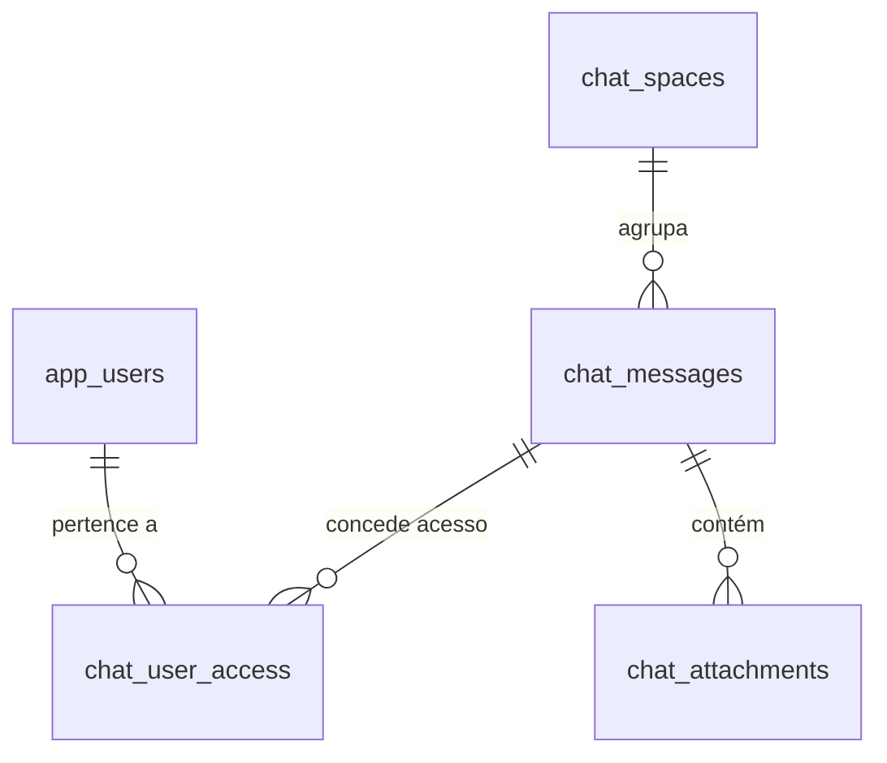

# Arquivo e Deduplicação do Google Chat

## 1. Desafio da Extração Multi-Utilizador
Numa organização, a mesma conversa de Google Chat ou Space surge habitualmente duplicada nos arquivos de exportação de múltiplos participantes.
Armazenar dezenas de cópias da mesma mensagem sobrecarregaria desnecessariamente o PostgreSQL e o armazenamento físico.

## 2. Estratégia de Deduplicação
O sistema implementa uma estratégia de deduplicação determinística:
1. **Identificador Preferencial:** `provider_message_id` emitido pela API do Google.
2. **Fallback Criptográfico:** Hash SHA-256 composto de forma estável:
   ```text
   SHA-256(SpaceName | ThreadId | SentAt_ISO | SenderEmail | NormalizedText)
   ```
3. **Restrição Única no PostgreSQL:** A coluna `source_hash` na tabela `chat_messages` possui índice único (`UNIQUE`), garantindo idempotência total mesmo em reprocessamento.

## 3. Matriz de Acessos (ACL)
Em vez de duplicar mensagens, o sistema associa utilizadores através da tabela `chat_user_access`:


## 4. Pesquisa Full-Text em PostgreSQL
As mensagens do Google Chat são indexadas com a funcionalidade nativa de pesquisa de texto do PostgreSQL através de uma coluna gerada armazenada (`search_vector tsvector`) com índice **GIN** (`idx_chat_messages_search`), permitindo pesquisas instantâneas por conteúdo, remetente e participantes em milhões de registos.
