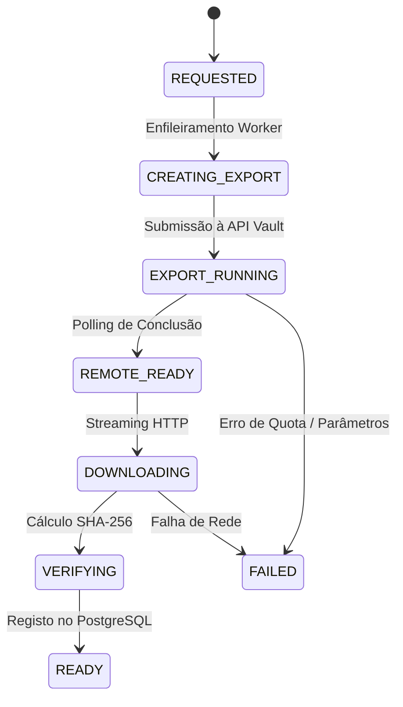

# Integração e Operação do Google Vault

## 1. Princípios de Desenho
- **Operações Não Simuladas:** Todas as exportações são solicitadas diretamente através dos endpoints oficiais da API Google Vault v1.
- **Matter Dedicado da Aplicação:** O sistema cria ou utiliza automaticamente um Matter dedicado denominado `MigrateSystem_Backup_Archive`. Matters jurídicos existentes da organização nunca são consultados ou afetados.
- **Controlo de Concorrência:** O Google Vault impõe limites de exportações concorrentes. A plataforma gere uma fila com taxa controlada através da variável `GOOGLE_VAULT_MAX_CONCURRENT_EXPORTS=2`.

## 2. Corpora Suportados
| Serviço | Corpus Vault | Formato Padrão | Utilização |
|---|---|---|---|
| Gmail | `MAIL` | MBOX | Arquivo individual de correio |
| Google Chat | `HANGOUTS_CHAT` | MBOX / JSON | Arquivo e indexação no portal "Meus Chats" |
| Google Groups | `GROUPS` | PST ou MBOX | Migração recomendada para Microsoft 365 |

## 3. Ciclo de Vida da Exportação

## 4. Transferência Direta por Streaming
As exportações do Vault ficam disponíveis temporariamente em buckets do Google Cloud Storage (`cloudStorageSink`). O sistema efetua download por streaming diretamente para o storage local, calculando o digest SHA-256 progressivamente e movendo o ficheiro atomicamente quando a integridade é confirmada.
